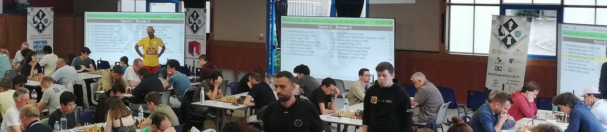

# Display

One of _Sharly Chess_'s flagship features is the ability to display pairings and live results during a tournament. These can be shown on a projector or a monitor plugged directly into the arbiter's computer, which needs no network at all, or on any other device [connected to the network](): a television in the playing hall, a tablet on which players enter their results, or the spectators' own phones.





Everything is set up from the **Display** entry of the event's side menu. While the event has nothing to display yet — no channel, screen, rotator, menu or timer — it opens the **Guide**; after that, it opens the last display tab you used. The tabs run along the top of the page:

{: .icon-list }
> - <i class="bi-signpost-split"></i> **Guide** – an interactive example of how it all fits together, with a button to create each kind of item.
> - <i class="bi-box-arrow-in-right"></i> **[Channels]()** – optional: devices whose content you change from the arbiter's computer.
> - <i class="bi-window"></i> **[Screens]()** – what is shown: pairings, results, rankings, check-in, a round-robin grid or an image, on one page or over several pages.
> - <i class="bi-repeat"></i> **[Rotators]()** – optional: several screens shown in turn, automatically.
> - <i class="bi-list-nested"></i> **[Menus]()** – optional: screens that people tap between.
> - <i class="bi-clock"></i> **[Timers]()** – optional: countdowns shown on the screens and rotators.

---

## How it fits together {#how-it-fits-together}

There are two questions to answer: **what to show**, and **how it reaches a device**.



### What to show

Everything starts with a **screen**. A screen shows one kind of information — the pairings, the last results, the ranking, the check-in, a round-robin grid or an image — in one of two ways:

- **one page, several tournaments**: you choose what goes on the page, which can mix several tournaments. Use it when everything fits on one page;
- **one tournament over several pages**: _Sharly Chess_ splits the tournament over as many pages as needed, and the pages turn by themselves. Use it when one tournament is too long for one page.

Screens can then be grouped, but they do not have to be:

- a **rotator** shows several screens in turn, automatically, which suits a projector or a television;
- a **menu** puts a bar of buttons at the top of the device, so that people can tap between its screens, which suits tablets and phones.

A screen can belong to any number of rotators and menus. A **timer** can be added to any screen or rotator.

### How it reaches a device

A device is either:

- **this computer**: a projector or a monitor plugged into the computer running _Sharly Chess_, on which you open the screen full screen. No network is needed;
- **a device on the network**: a tablet, a television or a computer on the same network, which opens _Sharly Chess_ by typing this computer's network address in its browser or by scanning the QR code shown in the _Sharly Chess_ window.

Either way, the device then opens one of two things:

- **a screen, a rotator or a menu, directly**. To change what the device shows, you then change it on the device itself;
- **a [channel]()**. The device opens the channel once, and from then on you decide from the arbiter's computer what the channel shows: a screen, one page of a screen over several pages, a rotator or a menu. Every device following the channel changes together.

A channel is not a way of connecting a device: a projector plugged into this computer can follow a channel just as well as a tablet on the network, and this is a common setup — the projector of the playing hall, driven from the arbiter's table without touching it. Channels are optional, but as soon as a device is out of reach, such as a projector on the ceiling or a television at the other end of the hall, they save a lot of walking.

---

## Setting up the screens before the tournament starts {#fake-data}

Before the first round is paired, a pairings or ranking screen has nothing to show, which makes it hard to choose its columns, its font size or the number of pages it needs.

The **Fake data** button, in the tab bar, solves this. While it is on, every individual tournament that has players but no pairings yet is shown on the screens with a made-up first round: the players are paired as the tournament's pairing system would pair them — top half against bottom half for a Swiss, first against last for a round robin or a knock-out, neighbours in the ranking for a Keizer — and every board has a result, so that the ranking and the last results have something to show too.

- The fake data is shown on **every device**, the public ones included, so that you can check the screens where they will really be seen.
- Every screen showing fake data carries a **This is fake data** notice in its middle, and the **Display** tabs show a yellow band with a **Turn off** button.
- **Nothing is saved**: the made-up round only exists while a screen is drawn, and results cannot be entered on it.
- Tournaments that are already paired keep their real data, and team tournaments are not covered.

The button only appears when there is a tournament it can be used for, or while it is on. Remember to turn it off before the players arrive.

---

## The Display page for visitors {#visitors}

Players and spectators connected to the network find a **Display** page in the event, which shows them what they can open, without the administration around it.

- If the event has public channels, the page starts with a preview of each of them. Choosing a channel opens it straight away, which is the quickest way to turn a device into a display.
- **Show all** lists the public screens, menus and rotators, by kind and then by screen type, each with a preview. Screens over several pages are shown as a stack of pages, and their pages can also be opened one by one.

{: .note }
> :information_source: Visitors only see what is marked as **public**. See [what connected devices can do](#what-can-connected-devices-do).
