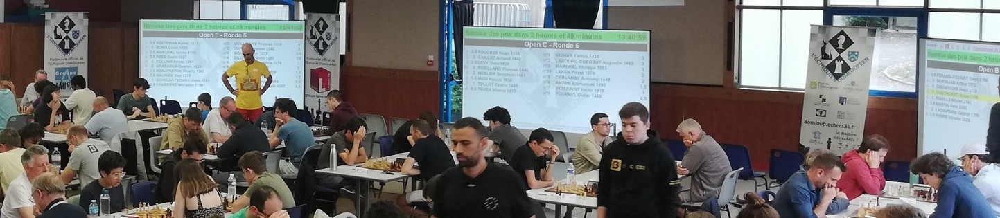

# Display

One of _Sharly Chess_'s flagship features is the ability to display pairings and live results during a tournament. These can be shown on a projector or a screen attached directly to the arbiter's machine, or on any other device [connected to the network](): a television in the playing hall, a tablet on which players enter their results, or the spectators' own phones.





Everything is set up from the **Display** entry of the event's side menu. Its tabs, along the top of the page, follow the order in which you would usually work:

{: .icon-list }
> - <i class="bi-box-arrow-in-right"></i> **[Feeds]()** – the devices you want to drive from the arbiter's computer, such as a projector.
> - <i class="bi-window"></i> **[Screens]()** – what is shown: pairings, results, rankings, check-in or an image, on [one page]() or [over several pages](#paged-screens).
> - <i class="bi-repeat"></i> **[Rotators]()** – several screens shown in turn, automatically.
> - <i class="bi-list-nested"></i> **[Menus]()** – screens that people tap between.
> - <i class="bi-clock"></i> **[Timers]()** – countdowns shown on the screens.

---

## How it fits together {#how-it-fits-together}

There are two questions to answer: **what to show**, and **how it reaches a device**.



**What to show** is a screen, a paged screen, a rotator or a menu:

- a **screen** shows one page that you fill yourself. It can mix several tournaments. Use it when everything fits on one page;
- a **paged screen** splits one tournament over as many pages as you ask for, and goes through them in turn. Use it when one tournament is too long for one page;
- a **rotator** shows different screens in turn, automatically;
- a **menu** lets people tap between screens, which suits tablets and phones.

**How it reaches a device** is either:

- **directly**: open the address of the screen, rotator or menu on the device. To change what it shows, you have to go to the device;
- **through a feed**: open the feed once on the device, and from then on change what it shows from the arbiter's computer. Any number of devices can follow the same feed.

A feed is optional, but as soon as a device is out of reach — a projector on the ceiling, a television at the other end of the hall — it saves a lot of walking.

{: .tip }
> :point_right: The <i class="bi-diagram-3"></i> button at the right of the tab bar opens a diagram of how screens, paged screens, rotators, menus and feeds fit together, and of when to use each of them.

---

## Setting up the screens before the tournament starts {#fake-data}

Before the first round is paired, a pairings or ranking screen has nothing to show, which makes it hard to choose its columns, its font size or the number of pages it needs.

The **Fake data** button, in the tab bar, solves this. While it is on, every individual tournament that has players but no pairings yet is shown on the screens with a made-up first round: the players are paired as the tournament's pairing system would pair them — top half against bottom half for a Swiss, first against last for a round robin or a knock-out, neighbours in the ranking for a Keizer — and every board has a result, so that the ranking and the last results have something to show too.

- The fake data is shown on **every device**, the public ones included, so that you can check the screens where they will really be seen.
- Every screen showing fake data carries a **This is fake data** notice in its middle, and the **Display** tabs show a yellow band with a **Turn off** button.
- **Nothing is saved**: the made-up round only exists while a screen is drawn, and results cannot be entered on it.
- Tournaments that are already paired keep their real data, and team tournaments are not covered.

The button only appears when there is a tournament it can be used for, or while it is on. Remember to turn it off before the players arrive.

---

## The Display page for visitors {#visitors}

Players and spectators connected to the network find a **Display** page in the event, which shows them what they can open, without the administration around it.

- If the event has public feeds, the page starts with a preview of each of them. Choosing a feed opens it straight away, which is the quickest way to turn a device into a display.
- **Show all** lists the public screens, menus and rotators, by kind and then by screen type, each with a preview. Paged screens are shown as a stack of pages, and their pages can also be opened one by one.

{: .note }
> :information_source: Visitors only see what is marked as **public**. See [what connected devices can do](#what-can-connected-devices-do).
