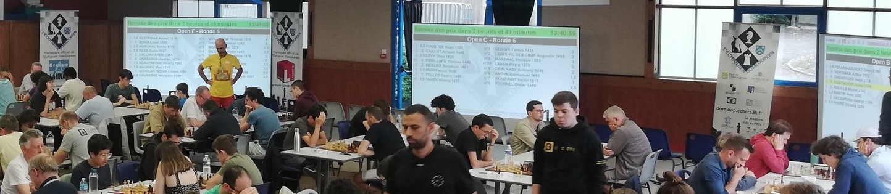

# Affichage

L'une des fonctionnalités phares de _Sharly Chess_ est la possibilité d'afficher les appariements et les résultats en direct pendant un tournoi. Ces informations peuvent être projetées sur un vidéoprojecteur ou un écran branché directement sur l'ordinateur de l'arbitre, ou sur n'importe quel autre appareil [relié au réseau]() : une télévision dans la salle de jeu, une tablette sur laquelle les joueur·euses saisissent leurs résultats, ou le téléphone des spectateur·ices.





Tout se configure depuis l'entrée **Affichage** du menu latéral de l'évènement. Ses onglets, en haut de la page, suivent l'ordre dans lequel on travaille habituellement :

{: .icon-list }
> - <i class="bi-box-arrow-in-right"></i> **[Flux]()** – les appareils que vous voulez piloter depuis l'ordinateur de l'arbitre, comme un vidéoprojecteur.
> - <i class="bi-window"></i> **[Écrans]()** – ce qui est affiché : appariements, résultats, classements, pointage ou image, sur [une page]() ou [sur plusieurs pages](#paged-screens).
> - <i class="bi-repeat"></i> **[Écrans rotatifs]()** – plusieurs écrans affichés à tour de rôle, automatiquement.
> - <i class="bi-list-nested"></i> **[Menus]()** – des écrans entre lesquels on navigue en touchant l'écran.
> - <i class="bi-clock"></i> **[Chronomètres]()** – des comptes à rebours affichés sur les écrans.

---

## Comment tout s'articule {#how-it-fits-together}

Il y a deux questions à se poser : **quoi afficher**, et **comment l'amener sur un appareil**.



**Ce qui est affiché** est un écran, un écran paginé, un écran rotatif ou un menu :

- un **écran** affiche une page que vous composez vous-même. Il peut mélanger plusieurs tournois. Utilisez-le quand tout tient sur une page ;
- un **écran paginé** répartit un tournoi sur autant de pages que vous le demandez, et les affiche à tour de rôle. Utilisez-le quand un tournoi est trop long pour une seule page ;
- un **écran rotatif** affiche différents écrans à tour de rôle, automatiquement ;
- un **menu** permet de naviguer entre des écrans en touchant l'écran, ce qui convient aux tablettes et aux téléphones.

**Pour l'amener sur un appareil**, deux possibilités :

- **directement** : ouvrez l'adresse de l'écran, de l'écran rotatif ou du menu sur l'appareil. Pour changer ce qu'il affiche, il faut alors aller jusqu'à l'appareil ;
- **par un flux** : ouvrez le flux une fois sur l'appareil, puis changez ce qu'il affiche depuis l'ordinateur de l'arbitre. Autant d'appareils que vous le souhaitez peuvent suivre le même flux.

Un flux n'est pas obligatoire, mais dès qu'un appareil est hors de portée — un vidéoprojecteur au plafond, une télévision à l'autre bout de la salle — il évite bien des allers-retours.

{: .tip }
> :point_right: Le bouton <i class="bi-diagram-3"></i> à droite de la barre d'onglets ouvre un schéma montrant comment s'articulent écrans, écrans paginés, écrans rotatifs, menus et flux, et quand utiliser chacun d'eux.

---

## Préparer les écrans avant le début du tournoi {#fake-data}

Avant l'appariement de la première ronde, un écran d'appariements ou de classement n'a rien à afficher, ce qui rend difficile le choix de ses colonnes, de sa taille de police ou de son nombre de pages.

Le bouton **Données fictives**, dans la barre d'onglets, résout ce problème. Tant qu'il est activé, chaque tournoi individuel qui a des joueur·euses mais pas encore d'appariements est affiché sur les écrans avec une première ronde inventée : les joueur·euses sont apparié·es comme le ferait le système d'appariement du tournoi — moitié haute contre moitié basse pour un système suisse, premier·ère contre dernier·ère pour un toutes-rondes ou une élimination directe, voisin·es au classement pour un Keizer — et chaque échiquier a un résultat, pour que le classement et les derniers résultats aient eux aussi quelque chose à afficher.

- Les données fictives s'affichent sur **tous les appareils**, y compris les appareils publics, pour que vous puissiez vérifier les écrans là où ils seront réellement vus.
- Chaque écran affichant des données fictives porte la mention **Données fictives** en son centre, et les onglets **Affichage** montrent un bandeau jaune avec un bouton **Désactiver**.
- **Rien n'est enregistré** : la ronde inventée n'existe que le temps d'afficher l'écran, et aucun résultat ne peut y être saisi.
- Les tournois déjà appariés gardent leurs vraies données, et les tournois par équipes ne sont pas concernés.

Le bouton n'apparaît que lorsqu'un tournoi peut en profiter, ou tant qu'il est activé. Pensez à le désactiver avant l'arrivée des joueur·euses.

---

## La page Affichage pour les visiteur·euses {#visitors}

Les joueur·euses et les spectateur·ices connecté·es au réseau trouvent dans l'évènement une page **Affichage**, qui leur montre ce qu'ils et elles peuvent ouvrir, sans l'administration autour.

- Si l'évènement a des flux publics, la page commence par un aperçu de chacun d'eux. Choisir un flux l'ouvre immédiatement : c'est le moyen le plus rapide de transformer un appareil en affichage.
- **Tout afficher** liste les écrans, menus et écrans rotatifs publics, par catégorie puis par type d'écran, chacun avec un aperçu. Les écrans paginés apparaissent comme une pile de pages, et leurs pages peuvent aussi être ouvertes une par une.

{: .note }
> :information_source: Les visiteur·euses ne voient que ce qui est **public**. Voir [ce que peuvent faire les appareils connectés](#what-can-connected-devices-do).
