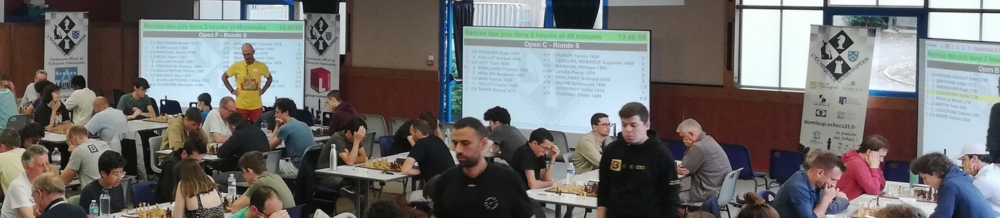

# Affichage

L'une des fonctionnalités phares de _Sharly Chess_ est la possibilité d'afficher les appariements et les résultats en direct pendant un tournoi. Ces informations peuvent être affichées sur un vidéoprojecteur ou un écran branché directement sur l'ordinateur de l'arbitre, sans aucun réseau, ou sur n'importe quel autre appareil [relié au réseau]() : une télévision dans la salle de jeu, une tablette sur laquelle les joueur·euses saisissent leurs résultats, ou le téléphone des spectateur·ices.





Tout se configure depuis l'entrée **Affichage** du menu latéral de l'évènement. Tant que l'évènement n'a encore rien à afficher — ni canal, ni écran, ni écran rotatif, ni menu, ni chronomètre —, elle ouvre le **Guide** ; ensuite, elle ouvre le dernier onglet d'affichage utilisé. Les onglets s'alignent en haut de la page :

{: .icon-list }
> - <i class="bi-signpost-split"></i> **Guide** – un exemple interactif de la façon dont tout s'articule, avec l'[assistant de création]() et un bouton pour créer chaque type d'élément.
> - <i class="bi-box-arrow-in-right"></i> **[Canaux]()** – facultatifs : des appareils dont vous changez le contenu depuis l'ordinateur de l'arbitre.
> - <i class="bi-window"></i> **[Écrans]()** – ce qui est affiché : appariements, résultats, classements, pointage, grille toutes-rondes ou image, sur une page ou sur plusieurs pages.
> - <i class="bi-repeat"></i> **[Écrans rotatifs]()** – facultatifs : plusieurs écrans affichés à tour de rôle, automatiquement.
> - <i class="bi-list-nested"></i> **[Menus]()** – facultatifs : des écrans entre lesquels on navigue en touchant l'écran.
> - <i class="bi-clock"></i> **[Chronomètres]()** – facultatifs : des comptes à rebours affichés sur les écrans et les écrans rotatifs.

{: .tip }
> :point_right: Vous découvrez les écrans ? L'[assistant de création]() vous demande ce que vous voulez mettre en place, et crée pour vous les écrans, le menu et le canal.

---

## Comment tout s'articule {#how-it-fits-together}

Il y a deux questions à se poser : **quoi afficher**, et **comment l'amener sur un appareil**.



### Quoi afficher

Tout commence par un **écran**. Un écran affiche un type d'information — les appariements, les derniers résultats, le classement, le pointage, une grille toutes-rondes ou une image — de l'une de deux façons :

- **une page, plusieurs tournois** : vous choisissez ce qui figure sur la page, qui peut mélanger plusieurs tournois. À utiliser quand tout tient sur une page ;
- **un tournoi sur plusieurs pages** : _Sharly Chess_ répartit le tournoi sur autant de pages que nécessaire, et les pages défilent toutes seules. À utiliser quand un tournoi est trop long pour une seule page.

Les écrans peuvent ensuite être regroupés, sans que ce soit obligatoire :

- un **écran rotatif** affiche plusieurs écrans à tour de rôle, automatiquement, ce qui convient à un vidéoprojecteur ou à une télévision ;
- un **menu** place une barre de boutons en haut de l'appareil, pour passer d'un de ses écrans à l'autre en touchant, ce qui convient aux tablettes et aux téléphones.

Un écran peut faire partie d'autant d'écrans rotatifs et de menus que vous le souhaitez. Un **chronomètre** peut être ajouté à n'importe quel écran ou écran rotatif.

### Comment l'amener sur un appareil

Un appareil est soit :

- **cet ordinateur** : un vidéoprojecteur ou un écran branché sur l'ordinateur où tourne _Sharly Chess_, sur lequel vous ouvrez l'écran en plein écran. Aucun réseau n'est nécessaire ;
- **un appareil sur le réseau** : une tablette, une télévision ou un ordinateur sur le même réseau, qui ouvre _Sharly Chess_ en tapant l'adresse réseau de cet ordinateur dans son navigateur ou en scannant le QR code affiché dans la fenêtre de _Sharly Chess_.

Dans les deux cas, l'appareil ouvre ensuite l'une de deux choses :

- **un écran, un écran rotatif ou un menu, directement**. Pour changer ce qu'affiche l'appareil, il faut alors le changer sur l'appareil lui-même ;
- **un [canal]()**. L'appareil ouvre le canal une fois, puis c'est depuis l'ordinateur de l'arbitre que vous décidez de ce qu'affiche le canal : un écran, une page d'un écran sur plusieurs pages, un écran rotatif ou un menu. Tous les appareils qui suivent le canal changent ensemble.

Un canal n'est pas un moyen de connecter un appareil : un vidéoprojecteur branché sur cet ordinateur peut suivre un canal aussi bien qu'une tablette sur le réseau, et c'est une configuration courante — le vidéoprojecteur de la salle de jeu, piloté depuis la table d'arbitrage sans y toucher. Les canaux ne sont pas obligatoires, mais dès qu'un appareil est hors de portée, comme un vidéoprojecteur au plafond ou une télévision à l'autre bout de la salle, ils évitent bien des allers-retours.

---

## Préparer les écrans avant le début du tournoi {#fake-data}

Avant l'appariement de la première ronde, un écran d'appariements ou de classement n'a rien à afficher, ce qui rend difficile le choix de ses colonnes, de sa taille de police ou de son nombre de pages.

Le bouton **Données fictives**, dans la barre d'onglets, résout ce problème. Tant qu'il est activé, chaque tournoi individuel qui a des joueur·euses mais pas encore d'appariements est affiché sur les écrans avec une première ronde inventée : les joueur·euses sont apparié·es comme le ferait le système d'appariement du tournoi — moitié haute contre moitié basse pour un système suisse, premier·ère contre dernier·ère pour un toutes-rondes ou une élimination directe, voisin·es au classement pour un Keizer — et chaque échiquier a un résultat, pour que le classement et les derniers résultats aient eux aussi quelque chose à afficher.

- Les données fictives s'affichent sur **tous les appareils**, y compris les appareils publics, pour que vous puissiez vérifier les écrans là où ils seront réellement vus.
- Chaque écran affichant des données fictives porte la mention **Données fictives** en son centre, et les onglets **Affichage** montrent un bandeau jaune avec un bouton **Désactiver**.
- **Rien n'est enregistré** : la ronde inventée n'existe que le temps d'afficher l'écran, et aucun résultat ne peut y être saisi.
- Les tournois déjà appariés gardent leurs vraies données, et les tournois par équipes ne sont pas concernés.

Le bouton n'apparaît que lorsqu'un tournoi peut en profiter, ou tant qu'il est activé. Pensez à le désactiver avant l'arrivée des joueur·euses.

---

## La page Affichage pour les visiteur·euses {#visitors}

Les joueur·euses et les spectateur·ices connecté·es au réseau trouvent dans l'évènement une page **Affichage**, qui leur montre ce qu'ils et elles peuvent ouvrir, sans l'administration autour.

- Si l'évènement a des canaux publics, la page commence par un aperçu de chacun d'eux. Choisir un canal l'ouvre immédiatement : c'est le moyen le plus rapide de transformer un appareil en affichage.
- **Tout afficher** liste les écrans, menus et écrans rotatifs publics, par catégorie puis par type d'écran, chacun avec un aperçu. Les écrans sur plusieurs pages apparaissent comme une pile de pages, et leurs pages peuvent aussi être ouvertes une par une.

{: .note }
> :information_source: Les visiteur·euses ne voient que ce qui est **public**. Voir [ce que peuvent faire les appareils connectés](#what-can-connected-devices-do).
