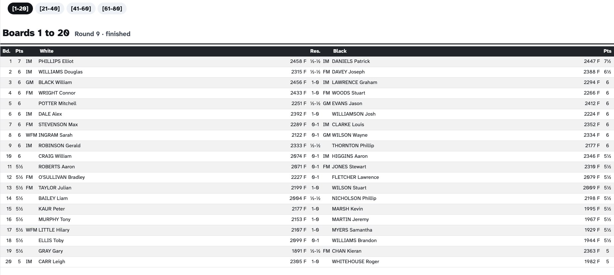

# Menus

A **menu** lets people move between screens themselves: a navigation bar at the top of the page lists its screens, and tapping one shows it. Menus suit the devices that people use with their hands — the tablets for result entry and check-in, or the spectators' phones.





---

## Creating a menu

On the **Display → Menus** tab, click **Create a menu**. A menu has:

- a **name**. Leave it empty to have a name derived from what the menu holds;
- a setting for its **paged screen submenus**: whether each [paged screen](#paged-screens) appears as a single entry opening a dropdown of its pages, or has its pages listed directly in the bar. Left on **Automatic**, paged screens appear as dropdowns when the menu holds more than one of them, and are expanded otherwise.

---

## Choosing what a menu holds

Click the menu's **Content** button. It can hold two kinds of entries:

- **Screen types** — every screen of a type at once, shown as _"All … screens"_. Screens of that type created later are added automatically;
- **Screens** — chosen one by one in a single list holding both the screens and the paged screens, grouped by screen type.

Drag the entries to set their order in the navigation bar. What the menu already holds is greyed out in the lists.

A screen can belong to **several menus** — the pairings can appear both in the players' menu and in the spectators' menu, for example.

The label of each entry is the **menu label** of the screen or paged screen; if it is empty, a label is derived automatically.

---

## Showing a menu

A menu has its own address, which opens it on its first entry. Open it with its <i class="bi-eye"></i> **view** button, or send it to a [feed]() with its <i class="bi-box-arrow-in-right"></i> button, so that every device following the feed shows the menu — the usual setup for the tablets of the playing hall.

The navigation bar only appears on screens opened through a menu: a screen opened directly shows only itself.

{: .note }
> :information_source: Visitors without a staff account only see the **public** screens of a menu; the private ones are left out.
