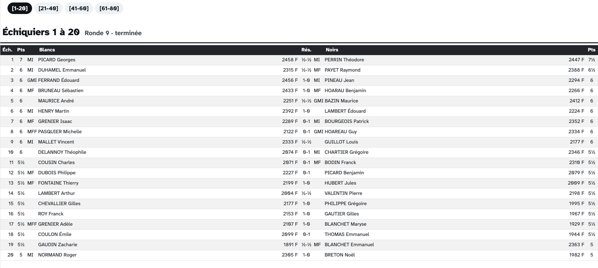

# Menus

Un **menu** permet de naviguer soi-même entre des écrans : une barre de navigation en haut de la page liste ses écrans, et toucher l'un d'eux l'affiche. Les menus conviennent aux appareils que l'on manipule — les tablettes de saisie des résultats et de pointage, ou le téléphone des spectateur·ices.





---

## Créer un menu

Dans l'onglet **Affichage → Menus**, cliquez sur **Créer un menu**. Un menu a :

- un **nom**. Laissez-le vide pour qu'un nom soit déduit de son contenu ;
- un réglage pour ses **sous-menus des écrans paginés** : chaque [écran paginé](#paged-screens) apparaît soit comme une seule entrée ouvrant un menu déroulant de ses pages, soit avec ses pages listées directement dans la barre. En mode **Automatique**, les écrans paginés apparaissent en menus déroulants quand le menu en contient plusieurs, et sont dépliés sinon.

---

## Choisir le contenu d'un menu

Cliquez sur le bouton **Contenu** du menu. Il peut contenir deux sortes d'entrées :

- des **types d'écran** — tous les écrans d'un type à la fois, affichés sous la forme _« Tous les écrans … »_. Les écrans de ce type créés plus tard sont ajoutés automatiquement ;
- des **écrans** — choisis un par un dans une liste unique regroupant les écrans et les écrans paginés, par type d'écran.

Faites glisser les entrées pour fixer leur ordre dans la barre de navigation. Ce que le menu contient déjà est grisé dans les listes.

Un écran peut appartenir à **plusieurs menus** — les appariements peuvent figurer à la fois dans le menu des joueur·euses et dans celui des spectateur·ices, par exemple.

Le libellé de chaque entrée est le **libellé de menu** de l'écran ou de l'écran paginé ; s'il est vide, un libellé est déduit automatiquement.

---

## Afficher un menu

Un menu a sa propre adresse, qui l'ouvre sur sa première entrée. Ouvrez-le avec son bouton <i class="bi-eye"></i> **voir**, ou envoyez-le à un [flux]() avec son bouton <i class="bi-box-arrow-in-right"></i>, pour que chaque appareil qui suit le flux affiche le menu — la configuration habituelle pour les tablettes de la salle de jeu.

La barre de navigation n'apparaît que sur les écrans ouverts depuis un menu : un écran ouvert directement n'affiche que lui-même.

{: .note }
> :information_source: Les visiteur·euses sans compte d'équipe d'organisation ne voient que les écrans **publics** d'un menu ; les écrans privés sont masqués.
