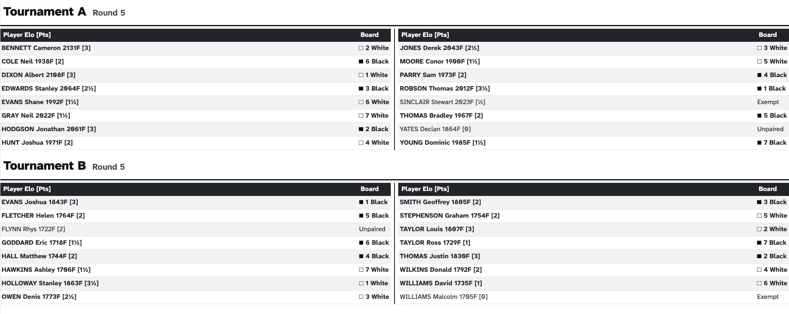
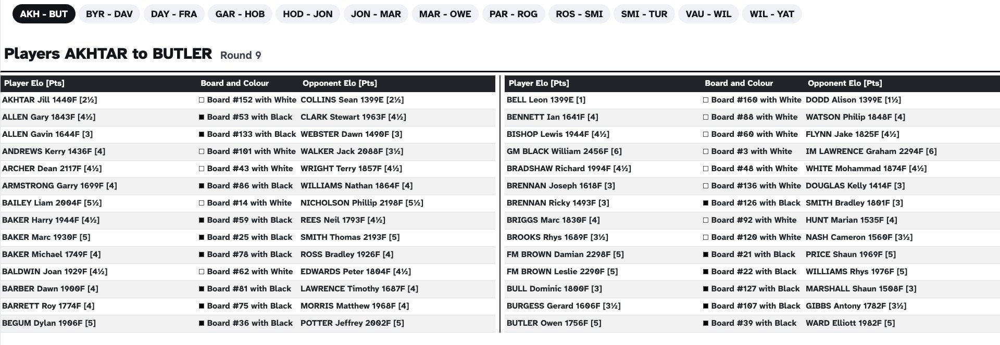

# Screens

A screen is a web page showing one kind of information: the pairings, the last results, the ranking, the check-in or an image. Screens are created and listed on the **Display → Screens** tab.

---

## Screen types

_Sharly Chess_ offers seven screen types:

{: .icon-list }
> - <i class="bi-check-square"></i> **Check-in** – the players of a tournament, who can check in themselves if the screen allows it.
> - <i class="bi-card-list"></i> **Pairings by board** – the pairings of the round, ordered by board number.
> - <i class="bi-people"></i> **Pairings by player** – the pairings of the round, in alphabetical order of the players.
> - <i class="bi-1-square"></i> **Last results** – the most recent results, most recent first.
> - <i class="bi-trophy"></i> **Ranking** – the current standings, optionally as a cross-table.
> - <i class="bi-grid-3x3"></i> **Round-robin grid** – every player of a round robin against every other, with the results and the rounds still to play.
> - <i class="bi-image"></i> **Image** – an image from a file or from the web.

The pairings and ranking screens of a tournament that has not started yet wait for its first round. To set them up before then, use the [fake data](#fake-data).

---

## One page or several pages {#one-page-or-several-pages}

A screen is shown either on one page or over several pages:

- **One or more tournaments, on one page** — you choose what goes on the page, and it can mix tournaments. Use it when everything fits on one page.
- **One tournament, over several pages** — a **paged screen**: one tournament is split automatically into as many pages as you ask for, which are shown in turn. Use it when one tournament is too long for one page.



Paged screens are available for the **Check-in**, **Pairings by board**, **Pairings by player** and **Ranking** types.

---

## Creating a screen

Click **Create a screen**, choose the screen type and, for the types that can be split, choose between **one page** and **several pages** at the top of the window. Then choose the **tournaments** to show — a paged screen shows a single tournament.

Most of the options are self-explanatory, but a few deserve more detail.

### Layout

- **Designed for** — the [feeds]() this screen is meant for, such as the projector or the tablets. The screen is then offered first when choosing what these feeds show, and carries their name in the list of screens. Nothing is sent to the feeds: it only helps you find the right screen later.
- **Columns** and **Font size adjustment** — useful when there are just slightly too many players to fit comfortably on the screen: an extra column or a slightly smaller font is often enough.

### Accepting input {#accepting-input}

The check-in, pairings by board and pairings by player screens can also be used to **enter something** from a shared device, such as a tablet in the playing hall:

- on a **check-in** screen, turn on **Players can check in on this screen** to let players check themselves in;
- on a **pairings** screen, turn on **Results can be entered on this screen** to let players enter their results. On the pairings by board screen, they tap their board; on the pairings by player screen, they tap their own name, which opens the result of their board. If the tournament records illegal moves, they can be entered from the pairings by board screen as well.

When the switch is on, you also choose whether the screen shows its **exit button**, which leaves the screen for the event's **Display** page. Leave it off on a tablet dedicated to result entry, so that the players stay on the screen.

{: .note }
> :information_source: A screen that accepts input cannot go through a [rotator](), and a paged screen that accepts input stays on its page instead of going through them, so that the screen does not change under someone using it.

Results can be entered on a public screen by anyone on the network, so think about who can reach the device. The [access levels]() let you decide whether results and check-ins can be entered through the public screens at all.

### Columns displayed {#columns-displayed}

Ranking screens, and their paged versions, have a checkbox for each column that can be hidden: the rating, the category, the gender, the federation and the club, the columns added by plugins, the first tie-break and the other tie-breaks. Unticking columns leaves room for the players on a screen showing a long ranking, especially when it is split over several columns. The choice applies to the cross-table too; on team tournaments, only the tie-breaks can be hidden.

### Menu label

The label used for this screen in the [menus]() that hold it. If left empty, the name of the tournament is used; a paged screen adds the range of each page.

### Timer

A [timer]() to show on the screen, for example to count down to the next round.

### Alert message

An alert message is shown in a yellow band along the bottom of the screen, and scrolls across it if it is too long to fit. It is a powerful tool on a large screen: *"Would players X and Y please enter their result!"*

A default message for the whole event, along with the background colour of the screens, is set with the <i class="bi-gear-fill"></i> settings button of the **Screens** tab; each screen can use it or show its own.

---

## Screens on one page

Once a screen on one page is created, its **Boards** button (or **Players**, depending on the type) opens the list of its **sets**. Each set shows part of a tournament — for example all its boards, or boards 1 to 20 — and a screen can show several sets, from the same tournament or from different ones. Drag the sets to choose their order.

This gives you a lot of flexibility. For example, with two tournaments and two tablets for result entry, you can:

- show the boards of **both tournaments** on each tablet, so that players use whichever is free;
- or show **one tournament per tablet**, so that each tournament has its own.

If your event has several small tournaments, such as a youth championship with one section per age, a single **pairings screen showing all the boards** of all the sections is perfect for a projector.





---

## Round-robin grids {#round-robin-grids}

A round-robin grid shows a round-robin tournament, individual or team, whether it follows the Berger tables or a schedule of its own: one row and one column per player, or per team. Each square holds the result of their game once it is played and published, and until then the round it is played in, such as _R 4_. On the right come the points, the tie-breaks and the rank.

- The grid is ordered by **pairing number**, so that every player keeps their row and column all through the tournament, or by **rank**, to bring the leaders to the top.
- The rating, the federation and the tie-breaks can be hidden with the **Columns displayed** checkboxes, to make room for a large grid.
- A team grid can be **detailed by player**: one row per player, grouped by team, with the results of their games. Lineups change from round to round, so it shows the games played only.

Only round-robin tournaments can be shown on a round-robin grid, and a new round robin gets one among its default screens. A grid stays on one page: for a long tournament, adjust the font size so that it fits the screen.

---

## Paged screens {#paged-screens}

When a tournament has too many players for one page, you could create several screens and give each a part of the boards — but that is tedious, and has to be redone whenever the number of players changes. A paged screen does it for you.





Besides the options of every screen, a paged screen has:

- the **first** and **last** board (or player, or team) to show, if you only want part of the tournament;
- for pairings by board, the **board selection**: by board number, or in the order of the pairings;
- the **number of pages**, or the **number of boards per page** (or players, or teams) — in which case _Sharly Chess_ works out how many pages are needed;
- the **seconds per page**: how long each page is shown when the pages turn. Left empty, each page is shown for 15 seconds, or for the rotator's delay when the paged screen is in a [rotator]().

A paged screen goes through its pages wherever it is shown:

- opened with its <i class="bi-eye"></i> **view** button, or sent to a [feed](), it shows its pages in turn;
- in a [rotator](), its pages are shown one after the other, among the rotator's other screens;
- in a [menu](), it appears as a single entry opening a submenu of its pages, or as one entry per page, depending on the menu's settings.

To show **one page only** on a device — for example the boards of the first page on a screen next to those boards — open the paged screen's details: each page has its own <i class="bi-eye"></i> view button and its own button to send that page to a feed.

---

## The list of screens

The **Screens** tab shows the screens on one page and the paged screens together. The chips above the list filter it by screen type, and the buttons at its top right show it as a **list**, as **cards**, or as **previews** — a live miniature of each screen, which is the quickest way to check them all at a glance. In the previews, a paged screen is drawn as a stack of pages, with its number of pages.

Each screen has buttons to:

- <i class="bi-eye"></i> **view** the screen, in a new tab of your browser;
- <i class="bi-box-arrow-in-right"></i> **send** it to a [feed](), so that the devices following the feed show it;
- **edit**, **duplicate** or **delete** it.

Turn on **Details** to see the full configuration of each screen in the list; for a paged screen, the details list its pages with the range each one shows.

{: .tip }
> :point_right: A screen's address can be opened directly on a device. A screen opened that way shows only itself: to let people move between screens, open a [menu]() instead.
