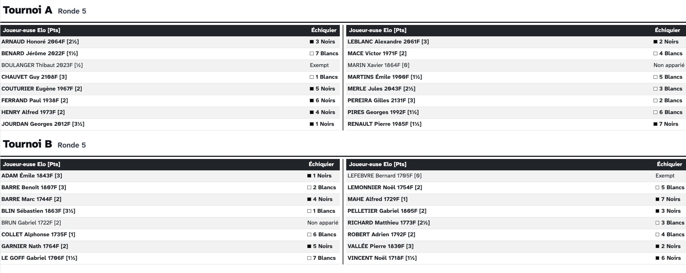
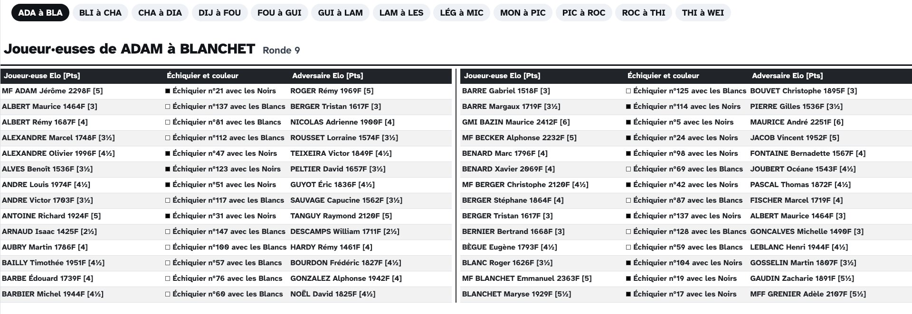

# Écrans

Un écran est une page web qui affiche un type d'information : les appariements, les derniers résultats, le classement, le pointage ou une image. Les écrans se créent et se listent dans l'onglet **Affichage → Écrans**.

---

## Types d'écran

_Sharly Chess_ propose sept types d'écran :

{: .icon-list }
> - <i class="bi-check-square"></i> **Pointage** – les joueur·euses d'un tournoi, qui peuvent se pointer elles et eux-mêmes si l'écran le permet.
> - <i class="bi-card-list"></i> **Appariements par échiquier** – les appariements de la ronde, triés par numéro d'échiquier.
> - <i class="bi-people"></i> **Appariements par ordre alphabétique** – les appariements de la ronde, triés par ordre alphabétique des joueur·euses.
> - <i class="bi-1-square"></i> **Derniers résultats** – les résultats les plus récents, du plus récent au plus ancien.
> - <i class="bi-trophy"></i> **Classement** – le classement actuel, éventuellement sous forme de grille américaine.
> - <i class="bi-grid-3x3"></i> **Grille toutes-rondes** – chaque joueur·euse d'un toutes-rondes face à tou·tes les autres, avec les résultats et les rondes restant à jouer.
> - <i class="bi-image"></i> **Image** – une image issue d'un fichier ou du web.

Les écrans d'appariements et de classement d'un tournoi qui n'a pas encore commencé attendent sa première ronde. Pour les préparer avant, utilisez les [données fictives](#fake-data).

---

## Une page ou plusieurs pages {#one-page-or-several-pages}

Un écran s'affiche soit sur une page, soit sur plusieurs pages :

- **Un ou plusieurs tournois, sur une page** — vous choisissez ce qui figure sur la page, qui peut mélanger plusieurs tournois. À utiliser quand tout tient sur une page.
- **Un seul tournoi, sur plusieurs pages** — un **écran paginé** : un tournoi est réparti automatiquement sur autant de pages que vous le demandez, affichées à tour de rôle. À utiliser quand un tournoi est trop long pour une seule page.



Les écrans paginés existent pour les types **Pointage**, **Appariements par échiquier**, **Appariements par ordre alphabétique** et **Classement**.

---

## Créer un écran

Cliquez sur **Créer un écran**, choisissez le type d'écran et, pour les types qui peuvent être découpés, choisissez entre **une page** et **plusieurs pages** en haut de la fenêtre. Choisissez ensuite les **tournois** à afficher — un écran paginé n'affiche qu'un seul tournoi.

La plupart des options sont explicites, mais certaines méritent quelques précisions.

### Présentation

- **Conçu pour** — les [flux]() auxquels cet écran est destiné, comme le vidéoprojecteur ou les tablettes. L'écran est alors proposé en premier quand vous choisissez ce que ces flux affichent, et porte leur nom dans la liste des écrans. Rien n'est envoyé aux flux : cela vous aide seulement à retrouver le bon écran plus tard.
- **Colonnes** et **Ajustement de la taille de police** — utiles quand il y a juste un peu trop de joueur·euses pour tout faire tenir confortablement à l'écran : une colonne de plus ou une police un peu plus petite suffit souvent.

### Saisie sur l'écran {#accepting-input}

Les écrans de pointage, d'appariements par échiquier et d'appariements par ordre alphabétique peuvent aussi servir à **saisir des informations** depuis un appareil partagé, comme une tablette dans la salle de jeu :

- sur un écran de **pointage**, activez **Les joueur·euses peuvent se pointer sur cet écran** pour leur permettre de se pointer elles et eux-mêmes ;
- sur un écran d'**appariements**, activez **Les résultats peuvent être saisis sur cet écran** pour permettre aux joueur·euses de saisir leurs résultats. Sur l'écran des appariements par échiquier, ils et elles touchent leur échiquier ; sur l'écran des appariements par ordre alphabétique, leur propre nom, qui ouvre le résultat de leur échiquier. Si le tournoi enregistre les coups illégaux, ceux-ci peuvent aussi être saisis depuis l'écran des appariements par échiquier.

Quand l'option est activée, vous choisissez aussi si l'écran affiche son **bouton de sortie**, qui quitte l'écran pour la page **Affichage** de l'évènement. Laissez-le désactivé sur une tablette réservée à la saisie des résultats, pour que les joueur·euses restent sur l'écran.

{: .note }
> :information_source: Un écran qui accepte la saisie ne peut pas faire partie d'un [écran rotatif](), et un écran paginé qui accepte la saisie reste sur sa page au lieu de les faire défiler, pour que l'écran ne change pas sous les yeux de la personne qui l'utilise.

Sur un écran public, n'importe qui sur le réseau peut saisir des résultats : pensez à qui peut accéder à l'appareil. Les [niveaux d'accès]() vous permettent de décider si les résultats et les pointages peuvent être saisis sur les écrans publics.

### Colonnes affichées {#columns-displayed}

Les écrans de classement, et leurs versions paginées, ont une case par colonne pouvant être masquée : l'Elo, la catégorie, le genre, la fédération et le club, les colonnes ajoutées par les plug-ins, le premier départage et les autres départages. Décocher des colonnes fait de la place aux joueur·euses sur un écran affichant un long classement, surtout quand il est réparti sur plusieurs colonnes. Le choix s'applique aussi à la grille américaine ; pour les tournois par équipes, seuls les départages peuvent être masqués.

### Libellé de menu

Le libellé utilisé pour cet écran dans les [menus]() qui le contiennent. S'il est laissé vide, le nom du tournoi est utilisé ; un écran paginé y ajoute la plage de chaque page.

### Chronomètre

Un [chronomètre]() à afficher sur l'écran, par exemple pour le compte à rebours avant la prochaine ronde.

### Message d'alerte

Un message d'alerte s'affiche dans un bandeau jaune en bas de l'écran, et défile s'il est trop long pour tenir. C'est un outil très efficace sur un grand écran : *« Les joueur·euses X et Y sont prié·es de saisir leur résultat ! »*

Un message par défaut pour tout l'évènement, ainsi que la couleur de fond des écrans, se règlent avec le bouton de paramètres <i class="bi-gear-fill"></i> de l'onglet **Écrans** ; chaque écran peut l'utiliser ou afficher le sien.

---

## Les écrans sur une page

Une fois un écran sur une page créé, son bouton **Échiquiers** (ou **Joueur·euses**, selon le type) ouvre la liste de ses **ensembles**. Chaque ensemble affiche une partie d'un tournoi — par exemple tous ses échiquiers, ou les échiquiers 1 à 20 — et un écran peut afficher plusieurs ensembles, du même tournoi ou de tournois différents. Faites glisser les ensembles pour choisir leur ordre.

Cela offre une grande souplesse. Par exemple, avec deux tournois et deux tablettes pour la saisie des résultats, vous pouvez :

- afficher les échiquiers des **deux tournois** sur chaque tablette, pour que les joueur·euses utilisent celle qui est libre ;
- ou afficher **un tournoi par tablette**, pour que chaque tournoi ait la sienne.

Si votre évènement comprend plusieurs petits tournois, comme un championnat jeunes avec un tournoi par catégorie d'âge, un seul **écran d'appariements affichant tous les échiquiers** de tous les tournois est idéal pour un vidéoprojecteur.





---

## Les grilles toutes-rondes {#round-robin-grids}

Une grille toutes-rondes montre un tournoi toutes-rondes, individuel ou par équipes, qu'il suive les tables de Berger ou un calendrier qui lui est propre : une ligne et une colonne par joueur·euse, ou par équipe. Chaque case contient le résultat de leur partie une fois jouée et publiée, et d'ici là la ronde où elle se joue, par exemple _R 4_. À droite figurent les points, les départages et le classement.

- La grille est ordonnée par **numéro d'appariement**, pour que chaque joueur·euse garde sa ligne et sa colonne pendant tout le tournoi, ou par **classement**, pour faire remonter les premier·ères.
- L'Elo, la fédération et les départages peuvent être masqués avec les cases **Colonnes affichées**, pour faire de la place à une grande grille.
- Une grille par équipes peut être **détaillée par joueur·euse** : une ligne par joueur·euse, groupée par équipe, avec les résultats de ses parties. Les compositions changeant d'une ronde à l'autre, elle ne montre que les parties jouées.

Seuls les tournois toutes-rondes peuvent être affichés sur une grille toutes-rondes, et un nouveau toutes-rondes en reçoit une parmi ses écrans par défaut. Une grille tient sur une seule page : pour un long tournoi, ajustez la taille de la police pour qu'elle tienne à l'écran.

---

## Les écrans paginés {#paged-screens}

Quand un tournoi a trop de joueur·euses pour une seule page, vous pourriez créer plusieurs écrans et donner à chacun une partie des échiquiers — mais c'est fastidieux, et c'est à refaire dès que le nombre de joueur·euses change. Un écran paginé s'en charge pour vous.





En plus des options de tout écran, un écran paginé a :

- le **premier** et le **dernier** échiquier (ou joueur·euse, ou équipe) à afficher, si vous ne voulez afficher qu'une partie du tournoi ;
- pour les appariements par échiquier, la **sélection des échiquiers** : par numéro d'échiquier, ou dans l'ordre des appariements ;
- le **nombre de pages**, ou le **nombre d'échiquiers par page** (ou de joueur·euses, ou d'équipes) — _Sharly Chess_ calcule alors le nombre de pages nécessaires ;
- les **secondes par page** : la durée d'affichage de chaque page quand les pages défilent. Laissé vide, chaque page est affichée 15 secondes, ou pendant le délai de l'écran rotatif quand l'écran paginé fait partie d'un [écran rotatif]().

Un écran paginé fait défiler ses pages partout où il est affiché :

- ouvert avec son bouton <i class="bi-eye"></i> **voir**, ou envoyé à un [flux](), il affiche ses pages à tour de rôle ;
- dans un [écran rotatif](), ses pages s'affichent l'une après l'autre, parmi les autres écrans ;
- dans un [menu](), il apparaît comme une seule entrée ouvrant un sous-menu de ses pages, ou comme une entrée par page, selon les réglages du menu.

Pour n'afficher **qu'une seule page** sur un appareil — par exemple les échiquiers de la première page sur un écran placé près de ces échiquiers — ouvrez les détails de l'écran paginé : chaque page a son propre bouton <i class="bi-eye"></i> pour la voir et son propre bouton pour l'envoyer à un flux.

---

## La liste des écrans

L'onglet **Écrans** affiche ensemble les écrans sur une page et les écrans paginés. Les pastilles au-dessus de la liste la filtrent par type d'écran, et les boutons en haut à droite l'affichent sous forme de **liste**, de **cartes** ou d'**aperçus** — une miniature en direct de chaque écran, le moyen le plus rapide de tous les vérifier d'un coup d'œil. Dans les aperçus, un écran paginé apparaît comme une pile de pages, avec son nombre de pages.

Chaque écran a des boutons pour :

- <i class="bi-eye"></i> **voir** l'écran, dans un nouvel onglet de votre navigateur ;
- <i class="bi-box-arrow-in-right"></i> l'**envoyer** à un [flux](), pour que les appareils qui suivent ce flux l'affichent ;
- le **modifier**, le **dupliquer** ou le **supprimer**.

Activez **Détails** pour voir la configuration complète de chaque écran dans la liste ; pour un écran paginé, les détails listent ses pages avec la plage affichée par chacune.

{: .tip }
> :point_right: L'adresse d'un écran peut être ouverte directement sur un appareil. Un écran ouvert ainsi n'affiche que lui-même : pour permettre de naviguer entre plusieurs écrans, ouvrez plutôt un [menu]().
